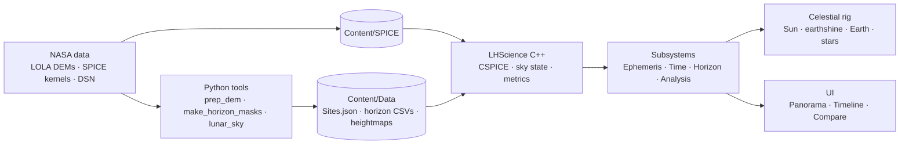

# Lunar Horizon

**Pick a spot near the lunar south pole and a date. Find out whether a lander there gets sunlight and can talk to Earth.**

Lunar Horizon computes the Sun and Earth in the sky from any point near the Moon's south pole, blocks them with the real terrain horizon from NASA LOLA elevation data, and turns the result into the numbers a mission planner cares about: percent of time in sunlight, the longest night, solar power, and how often Earth (and the Deep Space Network) is in view.

It has two parts:

- **A science pipeline in Python** (`tools/`) that is complete and validated against JPL Horizons to better than 0.0001°.
- **An Unreal Engine 5.8 app** (`LunarHorizon/`) that ports the same science to C++ and is meant to show it in photoreal 3D. The C++ science core is verified against the Python pipeline. The Unreal modules haven't been compiled yet.

> Started as pre-work for the NASA Space Apps Challenge 2026 ("CLPS Lunar Mission Browser"). It isn't a submitted entry. See [Status](#status).

## What it answers

From `lunar_sky.py` with 2 m eye-height horizon masks, 30 days from 2026-11-14:

| Site | Sunlit | Longest dark | Earth in view (DTE) | DSN coverage | Avg solar power |
|---|---|---|---|---|---|
| IM-2 landing site (`CLPS_IM2`) | 51.6 % | 311.5 h | 81.2 % | 98.0 % | 214.7 W |
| Malapert Massif (`ART_MALAPERT`) | 51.1 % | 211.0 h | 31.7 % | 98.0 % | 215.2 W |
| Mons Mouton region (`ART_MOUTON`) | 54.3 % | 322.5 h | 0.0 % | 98.0 % | 228.6 W |
| Haworth (`ART_HAWORTH`) | 34.6 % | 315.5 h | 18.8 % | 98.0 % | 145.2 W |
| Near Shackleton rim (`REF_A`) | 100.0 % | 0.0 h | 43.1 % | 98.0 % | 419.5 W |

The 0 % at Mons Mouton isn't a bug: the massif rises 11–14° toward Earth's direction and hides it for the whole window. These numbers cover one 30-day window. They are not yearly averages.

## Quick start (science pipeline, about 2 minutes)

Tested with Python 3.14. The SPICE kernels are already in the repo.

```bash
python3 -m venv .venv && . .venv/bin/activate
pip install -r requirements.txt
```

Run the built-in test (no kernels needed):

```bash
python tools/lunar_sky.py --selftest
```

Check the ephemeris against JPL Horizons (needs internet):

```bash
python tools/lunar_sky.py --kernels LunarHorizon/Content/SPICE --validate
```

Compute metrics for the IM-2 site, with its terrain horizon:

```bash
python tools/lunar_sky.py --kernels LunarHorizon/Content/SPICE --site -84.7906 29.1957 --height 5322.2 --mask LunarHorizon/Content/Data/Horizons/CLPS_IM2.csv --start 2026-11-14T00:00:00 --days 30
```

Add `--csv out.csv` to write the time series (30-minute steps).

### Check the C++ port (macOS)

Builds the `LHScience` core with clang (no Unreal) and compares every row with the Python output:

```bash
tools/cpp_check/run.sh REF_POLE CLPS_IM2
```

Expected result: `C++ matches Python oracle`, worst angle error about 5e-6°. The bundled `libcspice.a` is a macOS universal library, so this check runs on Macs only.

## How it works



1. **Sky position.** NAIF SPICE gives the azimuth and elevation of the Sun, Earth and the three DSN 70 m dishes from a point on the Moon (`MOON_ME` frame, DE440 ephemeris).
2. **Horizon mask.** For each site, `make_horizon_masks.py` ray-marches the terrain every 0.25° of azimuth: a 5 m LOLA grid out to 12 km and a 60 m grid out to 150 km. It does this at 2 m (eye height) and 10 m (lander mast).
3. **Metrics.** At each time step the Sun's visible fraction (as a disk, not a point) and Earth's visibility are checked against the mask. These are summed into illumination %, longest dark period, average power (1 m² vertical panel tracking the Sun, 30 % efficient), Direct-to-Earth % (Earth above the terrain and a DSN dish in view of the Moon) and DSN coverage %.

Full write-up: [docs/02 Science engine](docs/02-science-engine.md).

## Repository layout

```
tools/
  lunar_sky.py            Science reference: sky positions, masks, metrics, Horizons check
  prep_dem.py             LOLA DEMs -> per-site grids, Unreal heightmaps, site heights
  make_horizon_masks.py   Grids -> Content/Data/Horizons/<Id>.csv (2 m) and <Id>_10m.csv
  fetch_and_prep.sh       Rebuilds all site data from downloaded DEMs
  cpp_check/              Standalone C++ vs Python comparison
LunarHorizon/             Unreal Engine 5.8 project
  Source/LHScience/       C++ science core + UE subsystems + automation test
  Source/LunarHorizon/    Time, celestial rig, horizon overlay, panorama and timeline widgets
  Source/ThirdParty/CSPICE/  NAIF CSPICE headers + macOS static library
  Content/Data/           Sites.json (21 sites) and 42 horizon masks
  Content/SPICE/          The 8 SPICE kernels the app loads
dem/urls.txt              Where every LOLA DEM comes from
docs/                     Design documents (see below)
```

## Rebuilding the terrain data

The generated masks and `HeightM` values are already in the repo. To rebuild them, download the DEMs (about 12 GB) and run the pipeline:

```bash
mkdir -p dem && (cd dem && xargs -n1 curl -fLO < urls.txt)
```

```bash
tools/fetch_and_prep.sh
```

`fetch_and_prep.sh` only uses fully downloaded files, so you can re-run it as more DEMs finish. It writes the grids and hero heightmaps to `sites/` (ignored by git) and the masks to `LunarHorizon/Content/Data/Horizons/`.

To add a site, append an entry to `LunarHorizon/Content/Data/Sites.json` (`Id`, `Name`, `LatDeg`, `LonDeg`, `Kind`, `Source`, `Blurb`) and re-run the script.

## Unreal app

Needs Unreal Engine 5.8, Xcode 15.4+ (Mac) or Visual Studio 2022 (Windows), and [Cesium for Unreal](https://github.com/CesiumGS/cesium-unreal) 2.30.0.

1. Install Cesium for Unreal into `LunarHorizon/Plugins/CesiumForUnreal` or into the engine's plugin folder.
2. Open `LunarHorizon/LunarHorizon.uproject` and let it compile both modules.
3. Run the `LHScience` automation test from the Session Frontend.

The CSPICE library in the repo is macOS only. For Windows, download the CSPICE toolkit from [NAIF](https://naif.jpl.nasa.gov/naif/toolkit_C.html) rebuild it with `/MD`, and put it at `LunarHorizon/Source/ThirdParty/CSPICE/lib/Win64/cspice.lib` ([docs/04 §4.1](docs/04-unreal-architecture.md)).

Maps, materials and widget Blueprints aren't built yet. [docs/07 App plan](docs/07-app-plan.md) lists what's missing.

## Status

| Part | State |
|---|---|
| Science pipeline (`tools/`) | Done. Self-test passes and matches JPL Horizons to < 0.0001° |
| Terrain data (21 sites, 42 masks) | Done for every site with LOLA coverage |
| C++ science core | Done. Matches Python to 5e-6° |
| Unreal modules | Written, not compiled yet |
| Maps, materials, UI layouts | Not started (editor work) |

The project is paused.

## Documentation

These are the design documents written while planning the build. They describe the full intended app, including parts that don't exist yet.

| Doc | Covers |
|---|---|
| [00 Overview](docs/00-README.md) | Summary, tech stack, glossary |
| [01 Product & UX](docs/01-challenge-product-and-ux.md) | Users, screens, demo script |
| [02 Science engine](docs/02-science-engine.md) | SPICE, horizon masks, metrics, validation, C++ port |
| [03 Lunar data pipeline](docs/03-lunar-data-pipeline.md) | Datasets, site coordinates, GDAL recipes |
| [04 Unreal architecture](docs/04-unreal-architecture.md) | Modules, subsystems, actors, terrain, UI, packaging |
| [05 Photorealism](docs/05-photorealism.md) | Lighting values, regolith material, shadows, cinematics |
| [06 Build plan](docs/06-build-plan.md) | Schedule, risks, open questions |
| [07 App plan](docs/07-app-plan.md) | What exists vs. what's left, demo numbers |

## Data sources and credits

- **Terrain:** NASA LRO Lunar Orbiter Laser Altimeter. 5 m site DEMs and the 87.5°S mosaic from [NASA GSFC PGDA](https://pgda.gsfc.nasa.gov/data/LOLA_5mpp/); 20 m and 60 m polar GDRs from the [PDS Geosciences Node](https://pds-geosciences.wustl.edu/missions/lro/lola.htm).
- **Ephemerides:** [NAIF generic kernels](https://naif.jpl.nasa.gov/pub/naif/generic_kernels/) (DE440, Moon PA, DSN stations, leap seconds).
- **Validation:** [JPL Horizons](https://ssd.jpl.nasa.gov/horizons/).
- **Site coordinates:** NASA Artemis III candidate regions, LROC, and published CLPS landing reports. `CLPS_GRIFFIN1` is provisional: no landing point has been published.

## Third-party code

- **NAIF CSPICE** (`LunarHorizon/Source/ThirdParty/CSPICE/`), unmodified, from NASA JPL's Navigation and Ancillary Information Facility. See the [NAIF rules](https://naif.jpl.nasa.gov/naif/rules.html).
- **SPICE kernels** (`LunarHorizon/Content/SPICE/`), unmodified NAIF data.
- **Cesium for Unreal** (Apache 2.0) is a dependency, not included.

## License

Code and docs in this repository are MIT licensed (see [LICENSE](LICENSE)). The third-party files above keep their own terms.

Written with help from an AI assistant (Claude).
