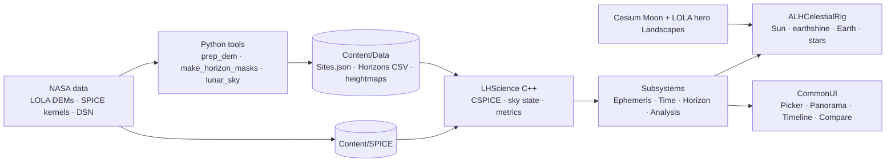

# Lunar Horizon: South Pole Mission Browser (Build Guide)

**NASA Space Apps Challenge 2026 · "CLPS Lunar Mission Browser" · Unreal Engine 5.8**

> Pick any spot near the lunar south pole and any date. See, in photoreal 3D and in plain numbers,
> whether a lander there gets sunlight and can talk to Earth. Every value comes from NASA data and
> is checked against JPL Horizons.

## Why this wins

| Criterion | Our edge |
|---|---|
| **Validity** | The science pipeline matched **JPL Horizons to < 0.0001°** for Sun and Earth on 2026-10-20 (`tools/lunar_sky.py --validate`). Terrain is LOLA 5 m/px with published error bars. |
| **Relevance** | Answers every verb of the challenge: compare sites, compare dates, Sun/Earth vs horizon, power, DTE. NASA LRO + SPICE + DSN data are the core. |
| **Impact** | One app for CLPS planners, teachers and the public. Live relevance: Griffin-1 (late 2026), VIPER on Blue Moon (2027), Artemis IV (2028). |
| **Creativity** | Game-engine photorealism driven by mission-grade ephemerides; a horizon panorama; a mast-height slider; an Apollo "Quindar" beep at Earthrise. |
| **Presentation** | The pole is the most cinematic place in the Solar System: 150 km shadows and Earth sinking behind mountains. |

## Architecture at a glance



**One frame:** sim UTC → `GetSkyState(site, utc)` (5 SPICE calls) → light rotations, intensities and
material parameters → HUD numbers. **One comparison:** async sweep over N sites × window →
`FLHSiteMetrics` → CompareCards + Timeline.

## Tech stack

| Layer | Choice |
|---|---|
| Engine | Unreal Engine 5.8 (Lumen, VSM, Nanite, MegaLights, Movie Render Graph) |
| Globe / geo | Cesium for Unreal 2.30.0, `IAU2015_Moon` ellipsoid, Cesium Moon tiles |
| Ephemeris | NAIF CSPICE N0067 (C++), spiceypy 8.3.0 (Python oracle) |
| Kernels | naif0012.tls, pck00011.tpc, moon_pa_de440_200625.bpc, moon_de440_250416.tf, de440s.bsp, earthstns_itrf93_260814.bsp, earth_topo_260814.tf, earth_latest_high_prec.bpc |
| Terrain | LOLA 5 m/px (PGDA), LOLA polar GDRs, LROC NAC mosaics |
| Data prep | GDAL, rasterio, NumPy |
| UI | CommonUI + Slate `NativePaint` charts |
| Distribution | Win64 build, 30-s video (Movie Render Graph), optional Pixel Streaming 2 |

## Reading order

1. [01 — Challenge, product & UX](01-challenge-product-and-ux.md): what we build, for whom, screen by screen, the pitch and the 30-s video.
2. [02 — Science engine](02-science-engine.md): SPICE, horizon masks, power/DTE metrics, validation, C++ port.
3. [03 — Lunar data pipeline](03-lunar-data-pipeline.md): datasets, preset sites with coordinates, GDAL recipes.
4. [04 — Unreal architecture](04-unreal-architecture.md): project setup, modules, C++ subsystems/actors, terrain, UI, packaging.
5. [05 — Photorealism](05-photorealism.md): lighting values, exposure, regolith material, shadows, sky, cinematics.
6. [06 — Build plan](06-build-plan.md): prep weeks, roles, the 48-hour schedule, risks, submission checklist, open questions.
7. [07 — App plan](07-app-plan.md): current status, toolchain blocker, next steps, resolved open items, demo numbers.

Reference code: [`tools/lunar_sky.py`](../tools/lunar_sky.py), the science oracle the Unreal port must match.

## First two hours (quick start)

```bash
python3 -m venv .venv && . .venv/bin/activate
pip install spiceypy numpy
python tools/lunar_sky.py --selftest
```

```bash
mkdir -p kernels && cd kernels && B=https://naif.jpl.nasa.gov/pub/naif/generic_kernels && for u in lsk/naif0012.tls pck/pck00011.tpc pck/moon_pa_de440_200625.bpc fk/satellites/moon_de440_250416.tf spk/planets/de440s.bsp spk/stations/earthstns_itrf93_260814.bsp fk/stations/earth_topo_260814.tf pck/earth_latest_high_prec.bpc; do curl -sfSO $B/$u; done; cd ..
```

```bash
python tools/lunar_sky.py --kernels kernels --validate
```

```bash
python tools/lunar_sky.py --kernels kernels --site -84.7906 29.1957 --start 2026-11-14T00:00:00 --days 30
```

Then install UE 5.8 + Cesium for Unreal 2.30.0 and follow chapter 04 §3.

## Glossary

| Term | Meaning |
|---|---|
| **CLPS** | Commercial Lunar Payload Services: NASA buying delivery of payloads on commercial landers |
| **PSR** | Permanently Shadowed Region: crater floors near the poles that never see the Sun |
| **Libration** | The Moon's apparent wobble. From the pole it makes Earth rise and set by ±6.7° |
| **DTE** | Direct-to-Earth communication with no relay satellite |
| **DSN** | NASA's Deep Space Network: Goldstone (USA), Madrid (Spain), Canberra (Australia) |
| **MOON_ME** | Mean Earth/polar-axis lunar frame, used by LOLA maps and site coordinates |
| **ET / TDB** | Ephemeris Time / Barycentric Dynamical Time, SPICE's internal time scale (≈ UTC + 69.18 s in 2026) |
| **`azlcpo`** | SPICE function returning azimuth/elevation of a body from a surface point |
| **Horizon mask** | Terrain elevation angle in every direction around a site |
| **Earthshine** | Sunlight reflected by Earth onto the Moon, ≈ 13 lux at full Earth |
| **Opposition surge** | Regolith brightening when looking directly away from the Sun |
| **Sub-solar longitude** | Longitude where the Sun is overhead. LROC low-Sun mosaics are binned by it |

## Status

- Science reference pipeline: **done and validated** (`tools/lunar_sky.py`, self-test + Horizons check,
  re-run 2026-10-21: worst error 0.0000°).
- Terrain data (2026-10-21): PGDA 5 m site DEMs, the 87.5°S 5 m mosaic and the 20/60 m LOLA polar GDRs
  are listed in `dem/urls.txt` (download them into `dem/`). `tools/fetch_and_prep.sh` turns
  them into per-site grids, hero heightmaps (`sites/<Id>_hero.png/.json`), `HeightM` in
  `Sites.json` and `Content/Data/Horizons/<Id>.csv` + `_10m.csv`.
- Unreal project `LunarHorizon/` (2026-10-21): `.uproject`, config, CSPICE (universal Mac lib),
  `LHScience` (subsystems, sweep, automation test) and `LunarHorizon` (time, celestial rig, horizon
  overlay, panorama + timeline widgets). The C++ science core is checked against the Python oracle by
  `tools/cpp_check/run.sh`; the Unreal modules are **not compiled yet** (needs UE 5.8 + Xcode).
  Maps, materials and WBP widgets are editor work. Rules: treat this as the pre-event prototype
  (06 §1) unless your Local Lead says otherwise.
- Open items to verify: [06 §9](06-build-plan.md#9-open-questions-to-resolve-all-verify-items).

*Prepared with an AI assistant (Claude). Disclose this on the Space Apps project page as the rules require.*
