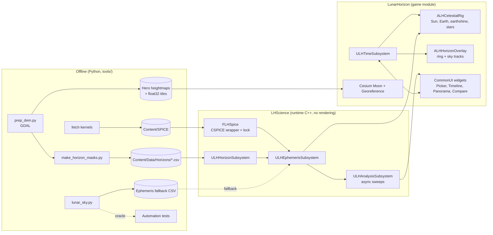

# 04 — Unreal Engine Architecture & Implementation

> **TL;DR** — Use **UE 5.8** (released June 17 2026) with **Cesium for Unreal 2.30.0** on its built-in
> `IAU2015_Moon` ellipsoid for the globe and regional terrain. Add a LOLA 5 m hero Landscape per preset
> site, with curvature applied in the material. A ~100-line **CSPICE** ThirdParty module feeds a
> `LHScience` runtime module, which is a port of `tools/lunar_sky.py`. Four subsystems (Ephemeris,
> Time, Horizon, Analysis) drive two actors (`ALHCelestialRig`, `ALHHorizonOverlay`) and a CommonUI
> front end. Charts are drawn with Slate in `NativePaint`, with no plugins and no browser. Ship as
> Win64 plus a Pixel Streaming 2 link for judges.

---

## 1. Engine version and machines

| Decision | Choice | Why |
|---|---|---|
| Engine | **Unreal Engine 5.8** | MegaLights and Movie Render Graph are Production Ready. Lumen Lite (beta) is a cheaper GI mode for laptops. Cesium for Unreal 2.30.0 ships 5.8 binaries. |
| Fallback | UE 5.7 | If a teammate's toolchain or plugin breaks. Cesium supports 5.6–5.8. MaxQ (if you use it) only has a 5.7 branch. |
| Primary dev OS | Windows 11 + NVIDIA RTX | Hardware ray tracing, path tracer and Pixel Streaming encoder all work best here |
| Mac | Fine for C++/UI/Blueprint work; look-dev on Windows | UE 5.8 needs macOS Sonoma 14+, Xcode 15.4+ recommended (15.2 minimum) |

Toolchains (from the UE 5.8 release notes): **Visual Studio 2022 17.14+** (VS 2026 recommended),
Windows SDK ≥ 10.0.22621.0. macOS: Sonoma 14+, Xcode 15.4+.

Hardware targets:

| Role | GPU | RAM | Disk |
|---|---|---|---|
| Look-dev / cinematics | RTX 3080 / 4070 or better, ≥ 12 GB VRAM | 64 GB | 250 GB NVMe free (engine + DDC + raw DEMs) |
| C++ / UI dev | Any RTX or Apple Silicon M-series | 32 GB | 150 GB |
| Pixel Streaming host | NVIDIA with NVENC (T4/A10G cloud or any RTX) | 16 GB | 50 GB |

---

## 2. System architecture



Per frame: `ULHTimeSubsystem` advances sim UTC → `ALHCelestialRig` asks
`ULHEphemerisSubsystem::GetSkyState(site, utc)` (~5 SPICE calls) → sets light rotations,
intensities and a Material Parameter Collection → the UI reads the same `FLHSkyState`.

Site comparison: the UI calls `ULHAnalysisSubsystem::RunSweepAsync(siteA…siteN, window)` → a worker
thread runs the sweep (SPICE serialized) → it broadcasts `FLHSiteMetrics` + time series → CompareCards
and Timeline repaint.

---

## 3. Create the project

1. Epic Launcher → install **5.8**. In *Options*, enable "Editor symbols for debugging" (Windows).
2. New Project → **Games → Blank**, **C++**, Target: Desktop, Quality: Maximum, **no** Starter Content,
   Raytracing **on**. Name: `LunarHorizon`.
3. **Edit → Project Settings**:

| Section | Setting | Value | Why |
|---|---|---|---|
| Engine › Rendering › Global Illumination | Dynamic GI Method | **Lumen** (High-end) / Lumen Lite (laptop preset) | Bounce light off sunlit crater walls into shadows. Bounce light is a major part of polar realism. |
| … › Reflections | Method | Lumen | |
| … › Shadows | Shadow Map Method | **Virtual Shadow Maps** | Crisp, km-long grazing shadows |
| … › Hardware Ray Tracing | Support Hardware Ray Tracing | On | Ray-traced shadows option, path tracer |
| … › Software Ray Tracing | Generate Mesh Distance Fields | On | Lumen software path, distance-field shadows far away |
| … › Default Settings | Auto Exposure | **Off** (we set manual EV in a PPV) | Real cameras on the Moon use fixed exposure (chapter 05) |
| … › Default Settings | Extend default luminance range | On (default) | Physical lux values |
| … › Default Settings | Motion Blur | Off | Data app, not a racing game |
| Engine › Rendering › Substrate | Substrate Materials | **Off** for the hackathon | Production-ready since 5.7, but switching mid-project is costly. Chapter 05's regolith works in the legacy pipeline. |
| Project › Maps & Modes | Game Instance Class | `LHGameInstance` (optional) | |
| Project › Packaging | Additional non-asset directories to copy | `SPICE`, `Data` | See §5 |

Large World Coordinates are on by default in UE5 (double-precision world, up to 88 million km).
Our scenes span a few hundred km, so nothing special is needed. Do keep world positions in `double`.

4. **Plugins** (Edit → Plugins):

| Plugin | Version | Use |
|---|---|---|
| **Cesium for Unreal** | 2.30.0 (Sep 29 2026; Fab or GitHub release `CesiumForUnreal-58-v2.30.0.zip`) | Moon globe, georeference, fly-to, regional terrain |
| **CommonUI** | built-in | Screen stack, input routing, gamepad/keyboard nav |
| Enhanced Input | built-in (default) | Camera controls |
| **Procedural Mesh Component** | built-in | Horizon ring, sky tracks |
| **Pixel Streaming 2** | built-in | Browser access for judges |
| Movie Render Queue / **Movie Render Graph** | built-in | 30-s trailer, hero stills (Graph is Production Ready in 5.8) |
| PCG | built-in | Boulder/crater scattering (chapter 05) |
| Niagara | built-in | Dust puff on touchdown, optional sky-track sparkles |
| Model View ViewModel | built-in, optional | Only if a teammate already knows MVVM; otherwise use C++ delegates |

**Do not** use `ACesiumSunSky`. It is built for Earth (it uses `SunPosition` for terrestrial lat/lon
and spawns a `SkyAtmosphere`). We drive our own lights from SPICE.

---

## 4. Folder and module layout

```
LunarHorizon/
├─ LunarHorizon.uproject
├─ Config/DefaultGame.ini            (non-UFS staging, §5)
├─ Content/
│  ├─ SPICE/                         (*.bsp, *.bpc, *.tf, *.tls, *.tpc — loose files, not assets)
│  ├─ Data/Sites.json
│  ├─ Data/Horizons/<SiteId>.csv
│  ├─ Data/Heightfields/<SiteId>.r32 + .json
│  ├─ Data/Ephemeris/<SiteId>_<YYYY>.csv   (fallback)
│  ├─ Maps/  L_Globe, L_Surface
│  ├─ UI/    WBP_Main, WBP_SitePicker, WBP_Timeline, WBP_HorizonPanorama, WBP_CompareCards, WBP_ExplainerCard
│  └─ Materials/ MPC_Lunar, M_Regolith, MF_Curvature, M_Earth, M_Stars, M_SkyTrack
├─ Source/
│  ├─ ThirdParty/CSPICE/   CSPICE.Build.cs, include/*.h, lib/Win64/cspice.lib, lib/Mac/libcspice.a
│  ├─ LHScience/           LHScience.Build.cs, Public/*.h, Private/*.cpp, Private/Tests/*.cpp
│  └─ LunarHorizon/        LunarHorizon.Build.cs, actors, UI glue
└─ tools/                  lunar_sky.py, prep_dem.py, make_horizon_masks.py
```

### 4.1 Build CSPICE as a static library

Download from <https://naif.jpl.nasa.gov/naif/toolkit_C.html>:
`PC, Windows, MS Visual C, 64bit` and `Mac/M1, OSX, clang, 64bit` (toolkit N0067).

**Windows: rebuild with `/MD`.** Unreal links the dynamic CRT. A static-CRT `cspice.lib` causes
`LNK2038`/`LNK4098` mismatches. From an *x64 Native Tools Command Prompt*, in `cspice\src\cspice`:

```bat
cl /c /O2 /MD /nologo /DMSDOS /DOMIT_BLANK_CC /DNON_ANSI_STDIO /D_COMPLEX_DEFINED *.c
lib /nologo /out:cspice.lib *.obj
```

**macOS: build a universal lib** from the `MacM1_OSX_clang_64bit` package with NAIF's own flags.
Its `SpiceZpl.h` already defines `CSPICE_MAC_OSX_M1_64BIT_CLANG`, so no platform define is needed
(done 2026-10-21: `Source/ThirdParty/CSPICE/lib/Mac/libcspice.a`, x86_64 + arm64). In `cspice/src/cspice`:

```bash
for A in arm64 x86_64; do
  mkdir -p o_$A && (cd o_$A && clang -c -ansi -O2 -fPIC -arch $A -DNON_UNIX_STDIO -Wno-everything -I../../../include ../*.c)
  ar rcs libcspice_$A.a o_$A/*.o
done
lipo -create libcspice_arm64.a libcspice_x86_64.a -output libcspice.a
```

Copy `cspice/include/*.h` to `Source/ThirdParty/CSPICE/include/`.

### 4.2 `CSPICE.Build.cs`

```csharp
using System.IO;
using UnrealBuildTool;

public class CSPICE : ModuleRules
{
    public CSPICE(ReadOnlyTargetRules Target) : base(Target)
    {
        Type = ModuleType.External;
        PublicSystemIncludePaths.Add(Path.Combine(ModuleDirectory, "include"));

        if (Target.Platform == UnrealTargetPlatform.Win64)
        {
            PublicAdditionalLibraries.Add(Path.Combine(ModuleDirectory, "lib", "Win64", "cspice.lib"));
            PublicDefinitions.AddRange(new[] { "MSDOS=1", "OMIT_BLANK_CC=1", "NON_ANSI_STDIO=1" });
        }
        else if (Target.Platform == UnrealTargetPlatform.Mac)
        {
            PublicAdditionalLibraries.Add(Path.Combine(ModuleDirectory, "lib", "Mac", "libcspice.a"));
        }
    }
}
```

### 4.3 `LHScience.Build.cs`

```csharp
using UnrealBuildTool;

public class LHScience : ModuleRules
{
    public LHScience(ReadOnlyTargetRules Target) : base(Target)
    {
        PCHUsage = PCHUsageMode.UseExplicitOrSharedPCHs;
        PublicDependencyModuleNames.AddRange(new[] { "Core", "CoreUObject", "Engine" });
        PrivateDependencyModuleNames.AddRange(new[] { "CSPICE", "Json", "JsonUtilities" });
    }
}
```

Register it in `LunarHorizon.uproject` → `"Modules"` (Type `Runtime`, LoadingPhase `Default`) and add
`"LHScience"` to both `*.Target.cs` `ExtraModuleNames`.

### 4.4 `LunarHorizon.Build.cs`

```csharp
PublicDependencyModuleNames.AddRange(new[] {
    "Core", "CoreUObject", "Engine", "InputCore", "EnhancedInput",
    "UMG", "Slate", "SlateCore", "CommonUI", "CommonInput",
    "ProceduralMeshComponent", "CesiumRuntime", "LHScience" });
```

### 4.5 Using MaxQ instead (alternative)

[MaxQ](https://github.com/Gamergenic1/MaxQ) (MIT, Gamergenic) wraps ~300 SPICE calls with
Blueprint nodes, ships prebuilt `cspice.lib`/`cspice.a`, and has branches up to `ue-5.7` (Dec 2025).
Choose it if your team is Blueprint-only **and** you stay on 5.7. Watch out: its `azlcpo` node
defaults `azccw = true` (counter-clockwise azimuth). Set it to **false** to match our convention. It
stages kernels with `+DirectoriesToAlwaysStageAsNonUFS=(Path="Spice")` and resolves relative paths
against `Content/`. Copy that pattern either way.

We roll our own because we need about 8 functions, want UE 5.8, and want one lock around every
call.

---

## 5. Kernels in packaged builds

`Config/DefaultGame.ini`:

```ini
[/Script/UnrealEd.ProjectPackagingSettings]
+DirectoriesToAlwaysStageAsNonUFS=(Path="SPICE")
+DirectoriesToAlwaysStageAsNonUFS=(Path="Data")
```

Non-UFS means the files are copied loose next to the `.pak`, so CSPICE's C `fopen` can read them.
UFS files inside a `.pak` are invisible to C code.

```cpp
// ULHEphemerisSubsystem::Initialize
const FString Dir = FPaths::ConvertRelativePathToFull(FPaths::ProjectContentDir() / TEXT("SPICE"));
TArray<FString> Kernels;
for (const TCHAR* K : { TEXT("naif0012.tls"), TEXT("pck00011.tpc"), TEXT("moon_pa_de440_200625.bpc"),
                        TEXT("moon_de440_250416.tf"), TEXT("de440s.bsp"),
                        TEXT("earthstns_itrf93_260814.bsp"), TEXT("earth_topo_260814.tf"),
                        TEXT("earth_latest_high_prec.bpc") })
{
    Kernels.Add(Dir / K);
}
```

Test the **packaged** build on day 1, not day 2. Kernel paths are the #1 "works in editor" bug.

---

## 6. Core types (`LHScience/Public/LHTypes.h`)

```cpp
#pragma once
#include "CoreMinimal.h"
#include "LHTypes.generated.h"

UENUM(BlueprintType)
enum class ELHSiteKind : uint8 { ArtemisRegion, CLPSMission, Reference, Custom };

USTRUCT(BlueprintType)
struct LHSCIENCE_API FLHSite
{
    GENERATED_BODY()
    UPROPERTY(EditAnywhere, BlueprintReadWrite) FString Id;
    UPROPERTY(EditAnywhere, BlueprintReadWrite) FString Name;
    UPROPERTY(EditAnywhere, BlueprintReadWrite) double LatDeg = -89.9;   // MOON_ME
    UPROPERTY(EditAnywhere, BlueprintReadWrite) double LonDeg = 0.0;     // east-positive
    UPROPERTY(EditAnywhere, BlueprintReadWrite) double HeightM = 0.0;    // above 1737.4 km sphere
    UPROPERTY(EditAnywhere, BlueprintReadWrite) ELHSiteKind Kind = ELHSiteKind::Custom;
    UPROPERTY(EditAnywhere, BlueprintReadWrite) FString Region;
    UPROPERTY(EditAnywhere, BlueprintReadWrite) FString Source;
    UPROPERTY(EditAnywhere, BlueprintReadWrite) FString Blurb;
};

USTRUCT(BlueprintType)
struct LHSCIENCE_API FLHSkyState
{
    GENERATED_BODY()
    UPROPERTY(BlueprintReadOnly) double SunAzDeg = 0, SunElDeg = 0;
    UPROPERTY(BlueprintReadOnly) double EarthAzDeg = 0, EarthElDeg = 0;
    UPROPERTY(BlueprintReadOnly) float SunVisibleFraction = 0;   // 0..1, horizon-masked solar disk
    UPROPERTY(BlueprintReadOnly) bool EarthVisible = false;
    UPROPERTY(BlueprintReadOnly) float EarthPhase = 0;           // illuminated fraction 0..1
    UPROPERTY(BlueprintReadOnly) bool DSNVisible = false;
    UPROPERTY(BlueprintReadOnly) double SunDistanceKm = 0, EarthDistanceKm = 0;
    UPROPERTY(BlueprintReadOnly) FVector SunDirMoonMe = FVector::ZeroVector;    // unit, body-fixed
    UPROPERTY(BlueprintReadOnly) FVector EarthDirMoonMe = FVector::ZeroVector;
};

USTRUCT(BlueprintType)
struct LHSCIENCE_API FLHHorizonMask
{
    GENERATED_BODY()
    UPROPERTY(BlueprintReadOnly) float AzimuthStepDeg = 0.25f;
    UPROPERTY(BlueprintReadOnly) TArray<float> ElevationDeg;

    float At(double AzDeg) const
    {
        if (ElevationDeg.Num() == 0) return 0.f;
        const double X = FMath::Fmod(FMath::Fmod(AzDeg, 360.0) + 360.0, 360.0) / AzimuthStepDeg;
        const int32 I = FMath::FloorToInt32(X) % ElevationDeg.Num();
        const float F = float(X - FMath::FloorToDouble(X));
        return FMath::Lerp(ElevationDeg[I], ElevationDeg[(I + 1) % ElevationDeg.Num()], F);
    }
};

USTRUCT(BlueprintType)
struct LHSCIENCE_API FLHSiteMetrics
{
    GENERATED_BODY()
    UPROPERTY(BlueprintReadOnly) float IlluminationPct = 0;
    UPROPERTY(BlueprintReadOnly) float LongestDarkHours = 0;
    UPROPERTY(BlueprintReadOnly) float DTEPct = 0;
    UPROPERTY(BlueprintReadOnly) float DSNCoveragePct = 0;
    UPROPERTY(BlueprintReadOnly) float AvgPowerW = 0;
    UPROPERTY(BlueprintReadOnly) FDateTime NextSunriseUtc;
    UPROPERTY(BlueprintReadOnly) FDateTime NextEarthriseUtc;
};
```

`FLHSpice` (the CSPICE wrapper with its lock) is in chapter 02 §10. Add one function to it for
rendering:

```cpp
// Unit vector from the site to Target, in MOON_ME, apparent (LT+S)
static bool DirMoonMe(const char* Target, double Et, const double ObsPos[3], FVector& OutDir)
{
    FScopeLock Guard(&Lock);
    SpiceDouble Obs[6] = { ObsPos[0], ObsPos[1], ObsPos[2], 0, 0, 0 }, State[6], Lt;  // spkcpo_c reads a 6-element STATE
    spkcpo_c(Target, Et, "MOON_ME", "OBSERVER", "LT+S", Obs, "MOON", "MOON_ME", State, &Lt);
    if (CheckError()) return false;
    OutDir = FVector(State[0], State[1], State[2]).GetSafeNormal();
    return true;
}
```

> **As built:** the CSPICE wrapper is plain C++ (`LHScience/Private/LHSpice.h/.cpp`, `std::recursive_mutex`)
> and the math is `LHScience/Public/LHCore.h`, so `tools/cpp_check/run.sh` builds and checks both
> against `lunar_sky.py` without the engine.

---

## 7. Subsystems

### 7.1 `ULHEphemerisSubsystem` (GameInstance)

```cpp
UCLASS()
class LHSCIENCE_API ULHEphemerisSubsystem : public UGameInstanceSubsystem
{
    GENERATED_BODY()
public:
    virtual void Initialize(FSubsystemCollectionBase& Collection) override;

    UFUNCTION(BlueprintCallable, Category="LunarHorizon")
    FLHSkyState GetSkyState(const FLHSite& Site, FDateTime Utc) const;

    UFUNCTION(BlueprintPure, Category="LunarHorizon") bool IsReady() const { return bReady; }
    const TArray<FLHSite>& GetSites() const { return Sites; }

private:
    bool bReady = false;
    TArray<FLHSite> Sites;
};
```

```cpp
void ULHEphemerisSubsystem::Initialize(FSubsystemCollectionBase& Collection)
{
    Collection.InitializeDependency<ULHHorizonSubsystem>();
    // ... build Kernels (§5) ...
    FString Err;
    bReady = FLHSpice::Init(Kernels, Err);
    if (!bReady) { UE_LOG(LogTemp, Error, TEXT("SPICE init failed: %s — using CSV fallback"), *Err); }

    FString Json;
    FFileHelper::LoadFileToString(Json, *(FPaths::ProjectContentDir() / TEXT("Data/Sites.json")));
    FJsonObjectConverter::JsonArrayStringToUStruct(Json, &Sites, 0, 0);
}

static void SiteVectorKm(const FLHSite& S, double Out[3])
{
    const double R = 1737.4 + S.HeightM / 1000.0;
    const double La = FMath::DegreesToRadians(S.LatDeg), Lo = FMath::DegreesToRadians(S.LonDeg);
    Out[0] = R * FMath::Cos(La) * FMath::Cos(Lo);
    Out[1] = R * FMath::Cos(La) * FMath::Sin(Lo);
    Out[2] = R * FMath::Sin(La);
}

FLHSkyState ULHEphemerisSubsystem::GetSkyState(const FLHSite& Site, FDateTime Utc) const
{
    FLHSkyState S;
    if (!bReady) return S;  // fallback: interpolate Data/Ephemeris CSV (not shown)
    const double Et = FLHSpice::UtcToEt(Utc);
    double Obs[3]; SiteVectorKm(Site, Obs);

    FLHAzEl Sun, Earth;
    FLHSpice::AzEl("SUN", Et, Obs, "MOON", "MOON_ME", Sun);
    FLHSpice::AzEl("EARTH", Et, Obs, "MOON", "MOON_ME", Earth);
    FLHSpice::DirMoonMe("SUN", Et, Obs, S.SunDirMoonMe);
    FLHSpice::DirMoonMe("EARTH", Et, Obs, S.EarthDirMoonMe);

    S.SunAzDeg = Sun.AzDeg;  S.SunElDeg = Sun.ElDeg;  S.SunDistanceKm = Sun.RangeKm;
    S.EarthAzDeg = Earth.AzDeg; S.EarthElDeg = Earth.ElDeg; S.EarthDistanceKm = Earth.RangeKm;

    const FLHHorizonMask* Mask = GetGameInstance()->GetSubsystem<ULHHorizonSubsystem>()->Find(Site.Id);
    const double SunR = FMath::RadiansToDegrees(FMath::Asin(695700.0 / Sun.RangeKm));
    S.SunVisibleFraction = LHScience::DiskVisibleFraction(Sun.ElDeg, Mask ? Mask->At(Sun.AzDeg) : 0.0, SunR);
    S.EarthVisible = Earth.ElDeg > (Mask ? Mask->At(Earth.AzDeg) : 0.0);
    S.EarthPhase = LHScience::EarthIlluminatedFraction(Et);   // phaseq_c, chapter 02 §5
    S.DSNVisible = LHScience::AnyDsnSeesMoon(Et);             // DSS-14/43/63 ≥ 10°
    return S;
}
```

`LHScience::DiskVisibleFraction` is the circular-segment formula from chapter 02 §6.4, line for line.

### 7.2 `ULHTimeSubsystem` (World, tickable)

```cpp
DECLARE_DYNAMIC_MULTICAST_DELEGATE_OneParam(FLHOnTimeChanged, FDateTime, Utc);

UCLASS()
class LUNARHORIZON_API ULHTimeSubsystem : public UTickableWorldSubsystem
{
    GENERATED_BODY()
public:
    virtual void Initialize(FSubsystemCollectionBase& C) override { Super::Initialize(C); }
    virtual void Tick(float Dt) override
    {
        if (!bPlaying) return;
        SimUtc += FTimespan::FromSeconds(double(Dt) * PlaybackRate);
        OnTimeChanged.Broadcast(SimUtc);
    }
    virtual TStatId GetStatId() const override { RETURN_QUICK_DECLARE_CYCLE_STAT(ULHTimeSubsystem, STATGROUP_Tickables); }

    UFUNCTION(BlueprintCallable) void SetTime(FDateTime Utc) { SimUtc = Utc; OnTimeChanged.Broadcast(SimUtc); }
    UFUNCTION(BlueprintCallable) void SetPlaybackRate(double SimSecondsPerSecond) { PlaybackRate = SimSecondsPerSecond; }
    UFUNCTION(BlueprintCallable) void SetPlaying(bool b) { bPlaying = b; }
    UFUNCTION(BlueprintPure) FDateTime GetTime() const { return SimUtc; }

    UPROPERTY(BlueprintAssignable) FLHOnTimeChanged OnTimeChanged;

private:
    FDateTime SimUtc = FDateTime(2026, 11, 14, 18, 0, 0);   // hackathon weekend
    double PlaybackRate = 1.0;
    bool bPlaying = false;
};
```

Preset rates: 1× (real time: the Sun moves 0.5°/hour, which is boring but honest), 1 h/s, 1 d/s, and
"a month in 30 s" (≈ 86,400 × 29.5 / 30 ≈ 85,000×).

### 7.3 `ULHHorizonSubsystem` (GameInstance)

Precomputed masks come from CSV. Masks for arbitrary points are computed async from a heightfield.

```cpp
const FLHHorizonMask* ULHHorizonSubsystem::Find(const FString& SiteId)
{
    if (const FLHHorizonMask* M = Masks.Find(SiteId)) return M;
    TArray<FString> Lines;
    const FString Path = FPaths::ProjectContentDir() / TEXT("Data/Horizons") / (SiteId + TEXT(".csv"));
    if (!FFileHelper::LoadFileToStringArray(Lines, *Path) || Lines.Num() < 2) return nullptr;
    FLHHorizonMask& M = Masks.Add(SiteId);
    for (int32 i = 1; i < Lines.Num(); ++i)            // skip header
    {
        FString Az, El;
        if (Lines[i].Split(TEXT(","), &Az, &El)) M.ElevationDeg.Add(FCString::Atof(*El));
    }
    M.AzimuthStepDeg = 360.f / FMath::Max(1, M.ElevationDeg.Num());
    return &M;
}

// Arbitrary clicked point: same algorithm as lunar_sky.horizon_mask, on a float heightfield
TFuture<FLHHorizonMask> ULHHorizonSubsystem::ComputeAsync(const FLHHeightField& HF, FVector2D GridXY,
                                                          double LonDeg, float EyeM)
{
    return Async(EAsyncExecution::ThreadPool, [&HF, GridXY, LonDeg, EyeM]()
    {
        FLHHorizonMask M; M.ElevationDeg.SetNumZeroed(1440);
        const double Lam = FMath::DegreesToRadians(LonDeg);
        const FVector2D North(FMath::Sin(Lam), FMath::Cos(Lam)), East(FMath::Cos(Lam), -FMath::Sin(Lam));
        const double H0 = HF.SampleBilinear(GridXY) + EyeM, R = 1737400.0, Step = 0.5 * HF.PixelM;
        ParallelFor(1440, [&](int32 i)
        {
            const double A = FMath::DegreesToRadians(i * 0.25);
            const FVector2D V = FMath::Cos(A) * North + FMath::Sin(A) * East;
            double Best = -90.0;
            for (double D = HF.PixelM; D < HF.MaxReachM; D += Step)
            {
                double H;
                if (!HF.TrySampleBilinear(GridXY + V * D, H)) break;
                Best = FMath::Max(Best, FMath::RadiansToDegrees(FMath::Atan2(H - H0 - D * D / (2 * R), D)));
            }
            M.ElevationDeg[i] = float(Best);
        });
        return M;
    });
}
```

`FLHHeightField` loads `Data/Heightfields/<SiteId>.r32`, raw little-endian float32 written by
`gdal_translate -of ENVI -ot Float32`, with a JSON sidecar `{width, height, pixel_m, x0, y0}` in
polar-stereographic metres. Downsample to 20–40 m and ±60 km for runtime use, about 10–35 MB per
region. For ±60 km at 40 m that is ≈ 3,000² floats, which is fine. Typical compute time is
0.1–0.3 s on 8 cores. Show a spinner while it runs.

### 7.4 `ULHAnalysisSubsystem` (GameInstance)

```cpp
USTRUCT(BlueprintType)
struct FLHSweepResult
{
    GENERATED_BODY()
    UPROPERTY(BlueprintReadOnly) FLHSite Site;
    UPROPERTY(BlueprintReadOnly) FLHSiteMetrics Metrics;
    UPROPERTY(BlueprintReadOnly) FDateTime StartUtc;
    UPROPERTY(BlueprintReadOnly) float StepMinutes = 30;
    UPROPERTY(BlueprintReadOnly) TArray<float> SunFraction;  // per step
    UPROPERTY(BlueprintReadOnly) TArray<bool> EarthVisible;
    UPROPERTY(BlueprintReadOnly) TArray<bool> DSN;
    UPROPERTY(BlueprintReadOnly) TArray<float> SunAz, SunEl, EarthAz, EarthEl; // for the panorama tracks
};

DECLARE_DYNAMIC_MULTICAST_DELEGATE_OneParam(FLHOnSweepDone, const TArray<FLHSweepResult>&, Results);
```

`RunSweepAsync(Sites, StartUtc, Days, StepMinutes)` runs on `EAsyncExecution::Thread` (one dedicated
thread, since SPICE is serialized anyway). It loops over steps calling the same functions as
`GetSkyState`, accumulates metrics exactly as `lunar_sky.metrics()` does, then hops back with
`AsyncTask(ENamedThreads::GameThread, [...]{ OnSweepDone.Broadcast(Results); })`. A 30-day,
30-minute sweep of 5 sites is about 7,200 states, well under a second.

---

## 8. `ALHCelestialRig`: Sun, Earth, earthshine, stars

Components: `Sun` (`UDirectionalLightComponent`), `Earthshine` (`UDirectionalLightComponent`),
`EarthMesh` (sphere, `M_Earth`), `StarSphere` (inverted sphere, `M_Stars`), and a reference to the
level's `ACesiumGeoreference`.

### 8.1 Directions: let Cesium do the frame math

Sunlight is parallel. Compute the Sun direction **once** in MOON_ME (body-fixed) and let the
georeference rotate it into Unreal space. That is correct anywhere on a curved Cesium globe, at the
pole, with no az/el singularity:

```cpp
void ALHCelestialRig::Apply(const FLHSkyState& S)
{
    // Cesium "ECEF" == body-fixed Cartesian of whatever ellipsoid the georeference uses (IAU2015_Moon)
    const FVector SunDirUE   = Georef->TransformEarthCenteredEarthFixedDirectionToUnreal(S.SunDirMoonMe).GetSafeNormal();
    const FVector EarthDirUE = Georef->TransformEarthCenteredEarthFixedDirectionToUnreal(S.EarthDirMoonMe).GetSafeNormal();

    // A directional light shines along its +X (forward) axis: point it *from* the Sun
    Sun->SetWorldRotation(FRotationMatrix::MakeFromX(-SunDirUE).Rotator());
    Sun->SetIntensity(SunLux * S.SunVisibleFraction * FMath::Square(149597870.7 / S.SunDistanceKm));

    Earthshine->SetWorldRotation(FRotationMatrix::MakeFromX(-EarthDirUE).Rotator());
    Earthshine->SetIntensity(EarthshineLux(S.EarthPhase) * (S.EarthVisible ? 1.f : 0.f));  // chapter 05 §3

    // Earth disk: put it far away along its direction and scale to its true angular size
    const double D = 5.0e7;                                  // 500 km in cm, beyond all terrain
    const double Rcm = D * FMath::Tan(FMath::Asin(6371.0 / S.EarthDistanceKm));
    const FVector Cam = GetWorld()->GetFirstPlayerController()->PlayerCameraManager->GetCameraLocation();
    EarthMesh->SetWorldLocation(Cam + EarthDirUE * D);
    EarthMesh->SetWorldScale3D(FVector(Rcm / 50.0));        // engine sphere has a 50 cm radius
    // Earth's own rotation/phase are handled in M_Earth from MPC_Lunar (chapter 05)

    UKismetMaterialLibrary::SetVectorParameterValue(this, MPC, TEXT("SunDirWS"), FLinearColor(SunDirUE));
    UKismetMaterialLibrary::SetVectorParameterValue(this, MPC, TEXT("EarthDirWS"), FLinearColor(EarthDirUE));
    UKismetMaterialLibrary::SetScalarParameterValue(this, MPC, TEXT("SunVisible"), S.SunVisibleFraction);
}
```

Stars: rotate `StarSphere` by the inertial→body rotation, so the sky turns correctly over the lunar
day: `pxform_c("J2000", "MOON_ME", et, R)`, then convert MOON_ME → Unreal with the georeference's
`ComputeEarthCenteredEarthFixedToUnrealTransformation()`.

### 8.2 Without Cesium (local Landscape only)

If a level has no georeference, use the same axis convention Cesium uses at its origin, East–South–Up:
**+X = East, +Y = South, +Z = Up**. Convert az/el yourself:

```cpp
static FVector AzElToUE(double AzDeg, double ElDeg)
{
    const double A = FMath::DegreesToRadians(AzDeg), E = FMath::DegreesToRadians(ElDeg);
    return FVector(FMath::Sin(A) * FMath::Cos(E),     // East
                  -FMath::Cos(A) * FMath::Cos(E),     // South = -North
                   FMath::Sin(E));                    // Up
}
// Sun->SetWorldRotation(FRotationMatrix::MakeFromX(-AzElToUE(S.SunAzDeg, S.SunElDeg)).Rotator());
```

Sanity test: az 90°, el 0° gives (1, 0, 0). The Sun is due east, so shadows point west (−X).

### 8.3 Light settings (values from chapter 05)

```cpp
Sun->SetMobility(EComponentMobility::Movable);
Sun->SetLightSourceAngle(0.533f);           // true solar disk → real penumbra
Sun->SetUseTemperature(true); Sun->SetTemperature(5778.f);
Sun->SetAtmosphereSunLight(false);          // there is no atmosphere
Earthshine->SetCastShadows(true);
Earthshine->SetLightSourceAngle(1.9f);      // Earth's disk: very soft shadows
```

---

## 9. `ALHHorizonOverlay`: the "AR layer" in the 3D world

This draws three things around the camera's site, at a fixed radius (e.g. 3 km) so they read as
"painted on the sky":

1. **Horizon ring**: the terrain mask as a thin glowing line. It proves the math matches the
   terrain you see.
2. **Sun track** (amber) and **Earth track** (blue) for the analysis window, with tick marks every
   24 h and small labels.
3. **Compass**: N/E/S/W letters on the ring and an "EARTH ▲" chevron when Earth is below the
   horizon.

```cpp
void ALHHorizonOverlay::BuildRibbon(int32 Section, const TArray<FVector>& DirsUE, float WidthCm,
                                    const FLinearColor& Color)
{
    TArray<FVector> V; TArray<int32> T; TArray<FVector> N; TArray<FVector2D> UV; TArray<FLinearColor> C;
    for (int32 i = 0; i < DirsUE.Num(); ++i)
    {
        const FVector P = DirsUE[i] * RadiusCm;
        const FVector Up = FVector::UpVector * WidthCm * 0.5f;      // vertical ribbon reads well at grazing angles
        V.Add(P - Up); V.Add(P + Up);
        UV.Add({ float(i) / DirsUE.Num(), 0 }); UV.Add({ float(i) / DirsUE.Num(), 1 });
        N.Add(-DirsUE[i]); N.Add(-DirsUE[i]); C.Add(Color); C.Add(Color);
        if (i > 0) { const int32 b = 2 * i; T.Append({ b - 2, b - 1, b, b - 1, b + 1, b }); }
    }
    Mesh->CreateMeshSection_LinearColor(Section, V, T, N, UV, C, {}, /*bCreateCollision*/ false);
    Mesh->SetMaterial(Section, M_SkyTrack);   // unlit, translucent, depth-test off for tracks behind terrain? see note
}
```

Horizon ring directions: `AzElToUE(az, mask(az))` for 1,440 azimuths, rotated into the georeference
frame. Sun track: `AzElToUE(SunAz[k], SunEl[k])` from the sweep.

Material `M_SkyTrack`: Unlit, Translucent, Emissive = Color × 4, opacity 0.85. Use two passes:
depth-tested (bright) plus a "behind terrain" copy with *Disable Depth Test* at 25 % opacity. Then
the Sun's path behind a ridge shows as a dotted ghost, so viewers see when the Sun is blocked.

---

## 10. Terrain strategy

| Layer | Extent | Tech | Source |
|---|---|---|---|
| Globe (site picker) | whole Moon | **Cesium Moon** tileset (Cesium ion) on `IAU2015_Moon` ellipsoid | Cesium ion (LRO-based) |
| Regional | to ~150 km around the site | Same Cesium tileset, with the hero area cut out | — |
| Hero | ±10 km around each preset | **Landscape 4033 × 4033 at 5 m** + curvature WPO + regolith material | LOLA/PGDA 5 m (chapter 03) |
| Far horizon visuals | 10–150 km | Cesium tiles (or a coarse Nanite mesh from the 40 m tile if Cesium misbehaves) | LOLA |

Why this split:
- **Landscape** gives Nanite support, Runtime Virtual Texturing, sculpt/paint tools and fast import.
  4033² at 5 m is a ~20 km square, exactly the PGDA region size. The recommended-size table tops out
  at 8129² (1,024 components).
- **Curvature matters at grazing light.** Over 10 km the surface drops 29 m (d²/2R). With the Sun at
  1.5°, a flat Landscape gets distant shadow lengths wrong. Fix it in the material with a World
  Position Offset function `MF_Curvature`: `WPO.z = −(Δx² + Δy²) / (2·173,740,000 cm)`, where Δ is
  the world XY offset from the site origin in cm. Collision stays flat, which is fine within
  walking range.
- **Cesium** handles curvature and streaming for everything else. To avoid z-fighting with the
  hero Landscape, put an `ACesiumCartographicPolygon` around the hero square and add a
  `UCesiumPolygonRasterOverlay` to the tileset to exclude those tiles.
- **Datum check:** a Cesium community report says Cesium's Moon terrain sits ~2.5 km higher than
  LOLA SLDEM2015 at the same lon/lat. Before mixing layers, sample a known peak with
  `UCesiumSampleHeightMostDetailedAsyncAction`, compare it with the LOLA DEM, and offset the
  Landscape to match (or offset the tileset). VERIFY on day 0.
- **Mesh Terrain** (UE 5.8, experimental) is not worth the hackathon risk.

### 10.1 Georeference at the site

```cpp
Georef->SetEllipsoid(LoadObject<UCesiumEllipsoid>(nullptr,
    TEXT("/CesiumForUnreal/Ellipsoids/IAU2015_Moon.IAU2015_Moon")));
Georef->SetOriginLongitudeLatitudeHeight(FVector(Site.LonDeg, Site.LatDeg, Site.HeightM));
```

The georeference origin becomes Unreal (0,0,0), with East–South–Up axes. Place the hero Landscape
so its center pixel (the site) sits at the origin. Its +X must be east and +Y south. Because grid
north differs from local north near the pole (chapter 03 §3), rotate the Landscape about Z by the
site longitude, **−λ**. VERIFY the sign visually: a known ridge must line up with the same ridge on
the Cesium tiles.

---

## 11. Camera and navigation

| Mode | Implementation |
|---|---|
| Globe orbit | Pawn orbiting the Moon center. Click a site → `UCesiumFlyToComponent::FlyToLocationLongitudeLatitudeHeight(...)` with the plugin's altitude/progress curves |
| Site orbit (default surface view) | Spring-arm camera around the site, 50 m–5 km, pitch limited to −5…−80° |
| Astronaut eye | `ACharacter`, camera at 1.7 m, `CharacterMovement->GravityScale = 0.165` (1.62 / 9.81), slow walk |
| Lander mast | Fixed camera at 10 m with a 360° pan. Pair it with the "mast height" toggle on the horizon mask |
| Cinematic | Sequencer camera rails for the trailer |

The transition from globe to surface is the "wow" moment. Fly from 3,000 km to 2 km in about 4 s
with ease-in-out. Swap Cesium for the hero Landscape at ~15 km altitude, hidden by a short exposure
ramp.

---

## 12. UI implementation

**Stack:** CommonUI. `WBP_Main` holds a `UCommonActivatableWidgetStack` for screens (Globe, Surface,
Compare) and persistent HUD parts (Timeline, Panorama). Use one dark theme (chapter 01 §8).

### 12.1 Charts with `NativePaint` (fast, crisp, no plugins)

```cpp
UCLASS()
class ULHHorizonPanoramaWidget : public UUserWidget
{
    GENERATED_BODY()
public:
    FLHHorizonMask Mask;                       // terrain skyline
    TArray<FVector2D> SunTrack, EarthTrack;    // (az, el) from the sweep
    FVector2D SunNow, EarthNow;
    float ElMin = -10.f, ElMax = 15.f;

protected:
    virtual int32 NativePaint(const FPaintArgs& Args, const FGeometry& G, const FSlateRect& Cull,
        FSlateWindowElementList& Out, int32 Layer, const FWidgetStyle& Style, bool bParentEnabled) const override
    {
        const FVector2D Sz = G.GetLocalSize();
        auto ToPx = [&](double Az, double El) {
            return FVector2D(Az / 360.0 * Sz.X, (1.0 - (El - ElMin) / (ElMax - ElMin)) * Sz.Y); };
        const FSlateBrush* White = FAppStyle::GetBrush("WhiteBrush");

        // terrain silhouette: one column per bin, filled to the bottom
        const float ColW = Sz.X / FMath::Max(1, Mask.ElevationDeg.Num()) + 1.f;
        for (int32 i = 0; i < Mask.ElevationDeg.Num(); ++i)
        {
            const FVector2D Top = ToPx(i * Mask.AzimuthStepDeg, Mask.ElevationDeg[i]);
            FSlateDrawElement::MakeBox(Out, Layer, G.ToPaintGeometry(FVector2D(ColW, Sz.Y - Top.Y),
                FSlateLayoutTransform(Top)), White, ESlateDrawEffect::None, FLinearColor(0.10f, 0.10f, 0.11f));
        }
        // tracks
        auto Poly = [&](const TArray<FVector2D>& AzEl, FLinearColor C) {
            TArray<FVector2D> P; for (const FVector2D& Q : AzEl) P.Add(ToPx(Q.X, Q.Y));
            FSlateDrawElement::MakeLines(Out, Layer + 1, G.ToPaintGeometry(), P, ESlateDrawEffect::None, C, true, 2.f); };
        Poly(SunTrack,   FLinearColor(1.00f, 0.66f, 0.10f));   // amber
        Poly(EarthTrack, FLinearColor(0.25f, 0.60f, 1.00f));   // blue
        // horizon line (el = 0) and markers are left as an exercise: MakeLines + MakeText
        return Layer + 2;
    }
};
```

(Split polylines where azimuth wraps 360 → 0.) **Timeline**: four rows (Sun ≥ 50 %, Earth visible,
DSN, DTE). Turn each boolean array into runs and draw one `MakeBox` per run. Mouse X → time →
`ULHTimeSubsystem::SetTime`. Call `Invalidate(EInvalidateWidgetReason::Paint)` only when data or
time changes.

Why not a Web Browser widget with a JS chart library: it is heavy (CEF), adds a second UI stack,
has input focus quirks, and doubles the GPU work under Pixel Streaming. Slate paint is ~100 lines
per chart and renders at native resolution.

### 12.2 Binding

Subsystems expose `BlueprintAssignable` delegates (`OnTimeChanged`, `OnSweepDone`, `OnSiteChanged`).
Widgets bind in `NativeConstruct`. No per-frame Blueprint bindings (property bindings tick every
frame).

### 12.3 Shareable state

Encode `site`, `t`, `mast`, `window` as a query string, e.g.
`?site=CLPS_IM2&t=2026-11-14T18:00:00Z&mast=10`.
- Packaged build: parse `FCommandLine::Get()` for `-LHState=...`. The **Copy link** button uses
  `FPlatformApplicationMisc::ClipboardCopy`.
- Pixel Streaming: the web frontend reads `location.search` and sends it via `emitUIInteraction`.
  The game receives it in the PS2 input handler and applies it.

---

## 13. Performance budget

| Target | Setting |
|---|---|
| 60 fps @ 1440p on RTX 3070-class | Lumen High, VSM, Nanite Landscape, Cesium `MaximumScreenSpaceError` 16 |
| 30 fps on laptops / Pixel Streaming | Lumen Lite, VSM, TSR at 67 % screen percentage, Cesium SSE 24 |
| Hero stills / trailer | Path tracer or Lumen Epic + HWRT shadows, Movie Render Graph, 8–16 spatial samples |

Expose Low/Medium/High/Cinematic via `UGameUserSettings::SetOverallScalabilityLevel` plus our own
cvars (`r.Lumen.*`, `r.Shadow.Virtual.*`). Profile with `stat unit`, `stat gpu` and Unreal Insights.
The science is negligible: under 1 ms per frame on the game thread. Sweeps run off-thread.

---

## 14. Packaging and distribution

1. **Platforms → Windows → Package Project** (Shipping). Check that `Content/SPICE` and `Content/Data`
   exist next to the pak in the output, then run on a clean machine.
2. **Mac:** Package for Mac. Unsigned builds need right-click → Open. Note it in the README.
3. **Pixel Streaming 2** (judges and the public open a link and get the real app in the browser):
   - Enable the plugin. Run the packaged app with
     `-PixelStreamingSignallingURL=ws://127.0.0.1:8888 -RenderOffScreen -ResX=1920 -ResY=1080 -ForceRes`
     (VERIFY flag names for PS2 in 5.8).
   - Run the signalling/web server from Epic's PixelStreamingInfrastructure repo (branch matching
     5.8): `SignallingWebServer/platform_scripts/cmd/start.bat` (Windows) or `bash/start.sh`.
   - Cloud host: one NVIDIA GPU VM (AWS g4dn/g5, Azure NV-series), started only for judging windows,
     a few USD per hour (VERIFY current pricing). Put the link on the project page **and** say
     "if offline, watch the video". Pixel Streaming is a bonus, not your demo.
4. The **30-second video** (Movie Render Graph) is the real submission artifact. See chapter 01.

---

## 15. Testing

Automation tests in `LHScience/Private/Tests/` compare C++ results with the Python oracle CSVs:

```cpp
IMPLEMENT_SIMPLE_AUTOMATION_TEST(FLHEphemerisMatchesPython, "LunarHorizon.Science.EphemerisVsPython",
    EAutomationTestFlags::EditorContext | EAutomationTestFlags::EngineFilter)

bool FLHEphemerisMatchesPython::RunTest(const FString&)
{
    // rows from: python tools/lunar_sky.py --site -89.9 0 --start 2026-11-01T00:00:00 --days 30 --csv pole_nov.csv
    FString Err;
    if (!TestTrue(TEXT("SPICE init"), FLHSpice::Init(LHTest::KernelPaths(), Err))) return false;

    TArray<FString> Lines;
    FFileHelper::LoadFileToStringArray(Lines, *(FPaths::ProjectDir() / TEXT("Source/LHScience/Private/Tests/pole_nov.csv")));
    const double Obs[3] = { 1737.4 * FMath::Cos(FMath::DegreesToRadians(-89.9)), 0.0,
                            1737.4 * FMath::Sin(FMath::DegreesToRadians(-89.9)) };
    for (int32 i = 1; i < Lines.Num(); i += 48)                 // one row per simulated day
    {
        TArray<FString> C; Lines[i].ParseIntoArray(C, TEXT(","));
        FDateTime Utc; FDateTime::ParseIso8601(*C[0], Utc);      // utc,sun_az,sun_el,...,earth_az,earth_el,...
        FLHAzEl Sun, Earth;
        const double Et = FLHSpice::UtcToEt(Utc);
        FLHSpice::AzEl("SUN", Et, Obs, "MOON", "MOON_ME", Sun);
        FLHSpice::AzEl("EARTH", Et, Obs, "MOON", "MOON_ME", Earth);
        TestNearlyEqual(TEXT("Sun el"),   Sun.ElDeg,   FCString::Atod(*C[2]), 1e-4);
        TestNearlyEqual(TEXT("Earth el"), Earth.ElDeg, FCString::Atod(*C[6]), 1e-4);
    }
    return true;
}
```

Run headless: `UnrealEditor-Cmd LunarHorizon.uproject -ExecCmds="Automation RunTests LunarHorizon; Quit" -unattended -nullrhi`.
Also add a **visual test**: a fixed camera at `REF_B` at a known UTC, a screenshot comparison, and a
manual check that the shadow terminator crosses the site when `SunVisibleFraction ≈ 0.5`.

---

## 16. Team split (Blueprint vs C++)

| Person | Owns | Language |
|---|---|---|
| Science dev | CSPICE module, `LHScience`, tests, Python tools | C++/Python |
| Engine dev | Subsystems ↔ actors, Cesium setup, cameras, packaging, Pixel Streaming | C++ |
| UI dev | CommonUI screens, `NativePaint` charts, explainer content | C++ + UMG |
| Tech artist | Landscape import, regolith material, lighting, PCG boulders, Earth/stars | Materials/BP |
| Storyteller/PM | Pitch, video, project page, judging-criteria checklist | — |

Use Git + LFS (`*.uasset`, `*.umap`, `*.bsp`, `*.bpc`) and One File Per Actor (World Partition) so
two people can edit the surface level. Lock maps in Unreal Revision Control if you use Perforce.

---

## 17. Pitfalls we have already paid for

- **Kernel paths in packaged builds**: stage them as non-UFS and load them with absolute paths (§5).
- **CRT mismatch** on Windows: rebuild CSPICE with `/MD` (§4.1).
- **CSPICE errors abort the process** by default: call `erract_c("SET",0,"RETURN")` first.
- **Threading**: one lock around every CSPICE call. Sweeps go on one worker thread, not the pool.
- **Azimuth handedness**: our convention is clockwise from north. MaxQ's default is counter-clockwise.
- **Grid north ≠ local north** near the pole: rotate the hero Landscape by −λ and check against Cesium.
- **Flat landscapes at grazing light**: add curvature WPO.
- **Cesium datum offset** vs LOLA (~2.5 km reported): measure and correct.
- **`ACesiumSunSky`** is Earth-only. Do not use it.
- **Auto exposure** ruins the polar look: use manual EV (chapter 05).
- **Property bindings** in UMG tick every frame: use delegates.

## Sources

- UE 5.8 announcement and release notes: <https://www.unrealengine.com/news/unreal-engine-5-8-is-now-available>, <https://dev.epicgames.com/documentation/unreal-engine/unreal-engine-5-8-release-notes>
- Landscape technical guide (sizes, Z scale): <https://dev.epicgames.com/documentation/en-us/unreal-engine/landscape-technical-guide-in-unreal-engine>
- Large World Coordinates: <https://dev.epicgames.com/documentation/en-us/unreal-engine/large-world-coordinates-in-unreal-engine-5>
- Cesium for Unreal releases and source (ellipsoids, georeference API): <https://github.com/CesiumGS/cesium-unreal/releases>
- Cesium Moon Terrain: <https://cesium.com/blog/2024/08/06/introducing-cesium-moon-terrain/>; datum thread: <https://community.cesium.com/t/cesium-ion-moon-terrain-appears-2-5-km-higher-than-lola-sldem2015-dem-at-the-same-lon-lat/46282>
- MaxQ: <https://github.com/Gamergenic1/MaxQ>
- NAIF CSPICE toolkit downloads: <https://naif.jpl.nasa.gov/naif/toolkit_C.html>
